<div align="center">

<br/><br/>

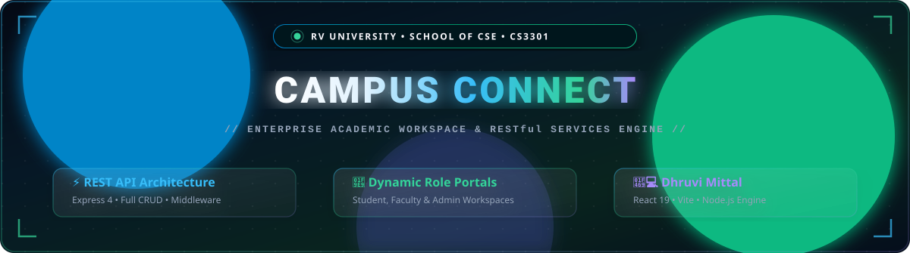

<br/><br/>

<p>
  
  
  
  
</p>

<br/>

<p>
  
  
  
  
  
  
</p>

<br/>

<p>
  
  <a href="https://github.com/Dhruvi-tech/Campus-Connect-Portal/stargazers"></a>
  <a href="https://github.com/Dhruvi-tech/Campus-Connect-Portal/network/members"></a>
  
</p>

<br/>

<h3>
  <a href="#-project-overview">Overview</a> &nbsp;•&nbsp;
  <a href="#-key-features">Features</a> &nbsp;•&nbsp;
  <a href="#%EF%B8%8F-tech-stack">Tech Stack</a> &nbsp;•&nbsp;
  <a href="#%EF%B8%8F-system-architecture">Architecture</a> &nbsp;•&nbsp;
  <a href="#-api-documentation">API</a> &nbsp;•&nbsp;
  <a href="#-screenshots--demonstration">Screenshots</a> &nbsp;•&nbsp;
  <a href="#-quickstart">Quickstart</a>
</h3>

<br/>


</div>


---

## 📑 Table of Contents

<details open>
<summary><b>Click to collapse / expand</b></summary>
<br/>

| # | Section | # | Section |
|:-:|:--|:-:|:--|
| 1 | [🌟 Project Overview](#-project-overview) | 8 | [🍃 MongoDB Configuration](#-mongodb-configuration) |
| 2 | [🎯 Objectives](#-objectives) | 9 | [🔌 API Documentation](#-api-documentation) |
| 3 | [✨ Key Features](#-key-features) | 10 | [⚙️ CRUD Implementation](#%EF%B8%8F-crud-implementation) |
| 4 | [🛠️ Tech Stack](#%EF%B8%8F-tech-stack) | 11 | [📸 Screenshots & Demo](#-screenshots--demonstration) |
| 5 | [🏛️ System Architecture](#%EF%B8%8F-system-architecture) | 12 | [🧪 Testing](#-testing--verification) |
| 6 | [📂 Folder Structure](#-project-folder-structure) | 13 | [🔮 Future Enhancements](#-future-enhancements) |
| 7 | [🚀 Quickstart](#-quickstart) | 14 | [👤 Author](#-author) |

</details>


---

## 🌟 Project Overview

**Campus Connect Portal** is a production-grade full-stack academic management platform engineered for **RV University's School of Computer Science & Engineering (CS3301 – Full Stack Development)**.

The application unifies student, faculty, and administrative operations into a single role-adaptive portal. Building on the component architecture of **Experiment 5** and the RESTful Express services of **Experiment 6**, **Experiment 7** adds persistent document storage with **MongoDB** and the **Mongoose ODM**.

> 💡 A React 19 client stays in real-time sync with an Express 4 REST backend, delivering a full CRUD lifecycle, schema enforcement, unique uppercase USN indexing, and instant UI feedback.

<div align="center">

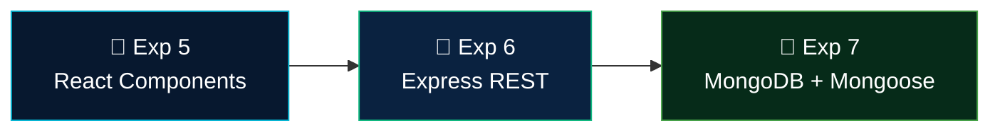

</div>


---

## 🎯 Objectives

| | Objective | What it delivers |
|:-:|:--|:--|
| 🏢 | **Enterprise Full-Stack Architecture** | Move from transient in-memory arrays to persistent, scalable NoSQL storage |
| 🧬 | **Schema Modeling & Validation** | Strict Mongoose schemas: type safety, trimming, uppercase transforms, uniqueness, numeric bounds |
| ⚡ | **Async RESTful Pipeline** | Non-blocking `async/await` handlers, standard HTTP codes, centralized error handling |
| 🎨 | **Interactive Components** | `StudentManager` with responsive forms, dynamic tables, inline edit, confirm dialogs |
| ✅ | **Quality Assurance** | Endpoints verified via automation, live browser runs, and direct `mongosh` inspection |


---

## ✨ Key Features

<table>
<tr>
<td width="50%" valign="top">

### 🎓 Student Management Suite
- **Add Student** – Name, USN, Department, Marks (`0 ≤ marks ≤ 100`)
- **Live Records Table** – dynamic grade badges
  - 🟢 Distinction **A+**
  - 🔵 First Class **A**
  - 🟡 Second Class **B**
  - 🔴 Remedial **F**
- **Inline Edit (PUT)** – pre-fills the form and saves to MongoDB
- **Safe Delete** – confirmation modal + instant table reconciliation
- **Refresh Persistence** – state survives page reloads

</td>
<td width="50%" valign="top">

### 🛡️ Validation & Safety
- Client-side **and** schema-level validation
- Rejects marks `< 0` or `> 100`
- **Duplicate USN** detection with clear feedback
- Centralized error envelopes (`success`, `message`)

### 🩺 Health Monitoring
- `/health` endpoint reports uptime and live status

</td>
</tr>
<tr>
<td width="50%" valign="top">

### 📢 Notice Board
- Categorized stream: **Urgent · New · Event · Official**
- Pop-up detail modals with full guidelines

### 📝 Assignments Tracker
- Toggle `Pending` ⇄ `Submitted ✓`

</td>
<td width="50%" valign="top">

### 📊 Attendance Tracker
- Live percentage + visual progress bar
- `+ Check In` lecture simulation

### 👤 Student Profile
- Name, SRN, semester, CGPA, editable bio

</td>
</tr>
</table>


---

## 🛠️ Tech Stack

<div align="center">


</div>

<br/>

| Layer | Technology | Version | Purpose |
|:--|:--|:-:|:--|
| 🖥️ Frontend | [React](https://react.dev/) | `19.2.8` | Component-based modular UI |
| ⚡ Build Tool | [Vite](https://vite.dev/) | `8.2.1` | Fast HMR bundler |
| 📡 HTTP Client | [Axios](https://axios-http.com/) | `1.19.0` | Promise-based request layer |
| 🟢 Runtime | [Node.js](https://nodejs.org/) | `24.x` | Async JavaScript engine |
| 🚂 Server | [Express](https://expressjs.com/) | `4.21.2` | Routing, middleware, JSON parsing |
| 🧬 ODM | [Mongoose](https://mongoosejs.com/) | `8.13.2` | Schemas, validation, queries |
| 🍃 Database | [MongoDB](https://www.mongodb.com/) | `7.0 / 8.0` | Document-oriented persistence |
| 🤖 QA | [Puppeteer-Core](https://pptr.dev/) | `25.11.0` | E2E automation & screenshots |


---

## 🏛️ System Architecture

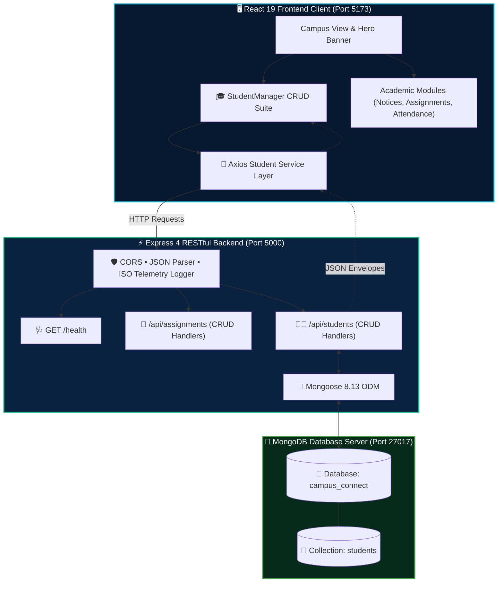

### 🔄 Request Lifecycle

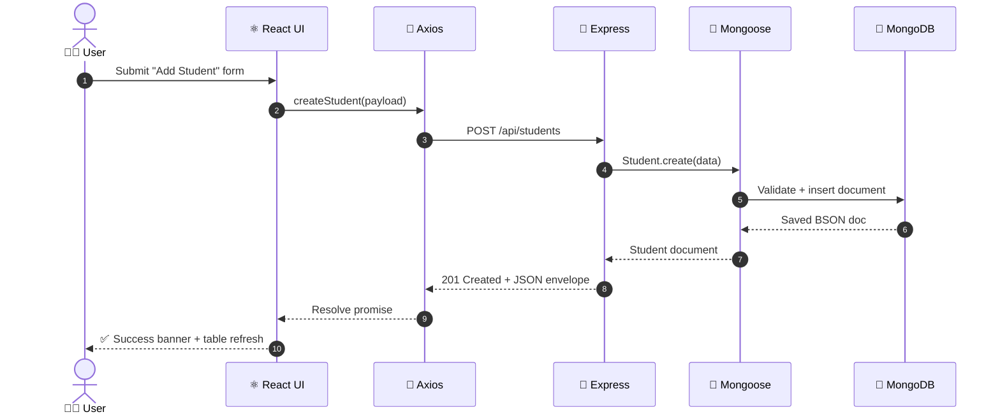


---

## 📂 Project Folder Structure

<details>
<summary><b>📁 Click to expand the full tree</b></summary>

```
campus-connect-portal/
├── assets/                          # Branding assets & vector dividers
│   ├── banner.svg                   # Institutional SVG header banner
│   └── footer.svg                   # Wave divider SVG footer
├── client/                          # React 19 Frontend (Vite)
│   ├── public/                      # Static client assets
│   ├── src/
│   │   ├── assets/                  # Carousel images & slide assets
│   │   ├── components/
│   │   │   ├── AuthModule.jsx       # Login & registration modal
│   │   │   ├── DetailModal.jsx      # Bulletin guidelines popup
│   │   │   ├── ItemCard.jsx         # Modular card with badges
│   │   │   ├── PortalHeader.jsx     # Slate portal header with back action
│   │   │   ├── PortalView.jsx       # Role portal tabs container
│   │   │   ├── RoleCard.jsx         # Role selection cards
│   │   │   ├── StudentManager.jsx   # Exp 7 MongoDB CRUD suite
│   │   │   └── TabBar.jsx           # Tabbed navigation
│   │   ├── services/
│   │   │   └── studentService.js    # Axios client for /api/students
│   │   ├── App.jsx                  # Root component
│   │   ├── main.jsx                 # Entry point
│   │   ├── portal.css               # Portal styling & animations
│   │   └── style.css                # Global responsive styles
│   ├── eslint.config.js            # ESLint config
│   ├── index.html                   # HTML5 template
│   ├── package.json                 # Client deps & scripts
│   └── vite.config.js               # Vite config (strict port 5173)
├── docs/
│   └── screenshots/                 # Live execution screenshots (01–26)
├── server/                          # Node.js Express Backend
│   ├── models/
│   │   └── Student.js               # Mongoose Student schema
│   ├── routes/
│   │   ├── assignmentRoutes.js      # Exp 6 assignment endpoints
│   │   └── studentRoutes.js         # Exp 7 MongoDB CRUD handlers
│   ├── src/
│   │   ├── config/
│   │   │   └── db.js                # Mongoose connection utility
│   │   └── models/
│   │       └── Student.js           # Re-export compatibility shim
│   ├── .env                         # Environment variables
│   ├── .env.example                 # Environment template
│   ├── index.js                     # Express bootstrap & route mounting
│   └── package.json                 # Server deps & scripts
├── .gitignore
├── package.json                     # Root metadata
└── README.md
```

</details>


---

## 📋 Prerequisites

| Tool | Required Version |
|:--|:--|
| 🟢 **Node.js** | `v18.0.0`+ (`v24.x` recommended) |
| 📦 **npm** | `v9.0.0`+ |
| 🍃 **MongoDB Community Server** | `v6.0`+ running on `mongodb://127.0.0.1:27017` |
| 🐚 **MongoDB Shell (`mongosh`)** | For direct database validation |

Verify MongoDB connectivity:

```bash
mongosh --eval "db.adminCommand({ ping: 1 })"
# Expected output: { ok: 1 }
```


---

## 🚀 Quickstart

<table>
<tr>
<td width="50%" valign="top">

### 1️⃣ Clone
```bash
git clone https://github.com/Dhruvi-tech/Campus-Connect-Portal.git
cd Campus-Connect-Portal
```

### 2️⃣ Start the Backend
```bash
cd server
npm install
npm run dev
```
> 📡 `http://localhost:5000`
> 🍃 Auto-connects to `mongodb://127.0.0.1:27017/campus_connect`

</td>
<td width="50%" valign="top">

### 3️⃣ Launch the Frontend
Open a **new terminal**:
```bash
cd client
npm install
npm run dev
```
> 🚀 `http://localhost:5173`

### ✅ You're live!
Open the portal → **Student Management** tab → add your first record.

</td>
</tr>
</table>


---

## 🔐 Environment Variables

Configured in `server/.env` (template: `server/.env.example`):

| Variable | Default | Description |
|:--|:--|:--|
| `PORT` | `5000` | Express REST API port |
| `MONGO_URI` | `mongodb://127.0.0.1:27017/campus_connect` | MongoDB connection string |
| `NODE_ENV` | `development` | Runtime mode |


---

## 🍃 MongoDB Configuration

Mongoose 8 connects to the `campus_connect` database. The schema lives in `server/models/Student.js`:

```javascript
import mongoose from 'mongoose';

const studentSchema = new mongoose.Schema(
  {
    name: {
      type: String,
      required: [true, 'Student name is required'],
      trim: true
    },
    usn: {
      type: String,
      required: [true, 'Student USN is required'],
      unique: true,
      uppercase: true,
      trim: true
    },
    department: {
      type: String,
      required: [true, 'Department is required'],
      trim: true
    },
    marks: {
      type: Number,
      required: [true, 'Marks are required'],
      min: [0, 'Marks cannot be less than 0'],
      max: [100, 'Marks cannot exceed 100']
    }
  },
  {
    timestamps: true
  }
);

const Student = mongoose.model('Student', studentSchema);
export default Student;
```


---

## 🔌 API Documentation

All responses follow a standardized JSON envelope.

| Method | Endpoint | Status | Description |
|:-:|:--|:-:|:--|
|  | `/api/students` | `200` | Retrieve all students |
|  | `/api/students/:id` | `200` | Retrieve one student by `_id` |
|  | `/api/students` | `201` | Create a new student |
|  | `/api/students/:id` | `200` | Update profile and marks |
|  | `/api/students/:id` | `200` | Permanently delete a student |
|  | `/api/assignments` | `200` | Fetch course assignments |
|  | `/health` | `200` | Health & uptime monitor |

<details>
<summary><b>➕ Create Student — <code>POST /api/students</code></b></summary>

**Request**
```json
{
  "name": "Rahul Sharma",
  "usn": "BSC001",
  "department": "Computer Science",
  "marks": 75
}
```

**Response · `201 Created`**
```json
{
  "success": true,
  "message": "Student created successfully",
  "data": {
    "_id": "673010b9a2d8e4001f3e1a01",
    "name": "Rahul Sharma",
    "usn": "BSC001",
    "department": "Computer Science",
    "marks": 75,
    "createdAt": "2026-11-05T09:00:00.000Z",
    "updatedAt": "2026-11-05T09:00:00.000Z"
  }
}
```
</details>

<details>
<summary><b>✏️ Update Student — <code>PUT /api/students/:id</code></b></summary>

**Request**
```json
{
  "marks": 85
}
```

**Response · `200 OK`**
```json
{
  "success": true,
  "message": "Student updated successfully",
  "data": {
    "_id": "673010b9a2d8e4001f3e1a01",
    "name": "Rahul Sharma",
    "usn": "BSC001",
    "department": "Computer Science",
    "marks": 85,
    "updatedAt": "2026-11-05T09:02:15.000Z"
  }
}
```
</details>

<details>
<summary><b>⚠️ Validation Error — <code>400 Bad Request</code></b></summary>

```json
{
  "success": false,
  "message": "Validation Error: marks must be a number between 0 and 100"
}
```
</details>

<details>
<summary><b>🚫 Duplicate USN — <code>400 Bad Request</code></b></summary>

```json
{
  "success": false,
  "message": "Duplicate USN Error: A student with USN \"BSC001\" already exists"
}
```
</details>


---

## ⚙️ CRUD Implementation

| Operation | Route Handler | Mongoose Query | Client Call |
|:--|:--|:--|:--|
| ➕ **Create** | `router.post('/')` | `Student.create(data)` | `createStudent(payload)` |
| 📖 **Read All** | `router.get('/')` | `Student.find().sort({ createdAt: -1 })` | `getStudents()` |
| 🔍 **Read One** | `router.get('/:id')` | `Student.findById(id)` | `getStudent(id)` |
| ✏️ **Update** | `router.put('/:id')` | `Student.findByIdAndUpdate(id, data, { new: true, runValidators: true })` | `updateStudent(id, payload)` |
| 🗑️ **Delete** | `router.delete('/:id')` | `Student.findByIdAndDelete(id)` | `deleteStudent(id)` |


---

## 📸 Screenshots & Demonstration

<div align="center">

</div>

> 📷 Every screenshot is a **genuine execution output** from the live app, terminal sessions, Postman runs, and database shells.

### 🖥️ A. Application Interface

<table>
<tr>
<td width="50%" align="center" valign="top">
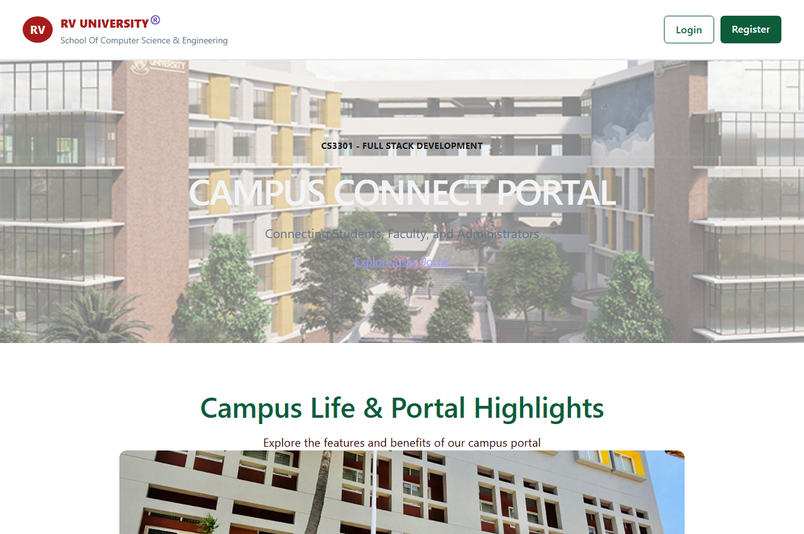<br/>
<b>1 · Homepage</b><br/>
<sub>RV University nav bar, CS3301 hero banner, animated campus carousel.</sub>
</td>
<td width="50%" align="center" valign="top">
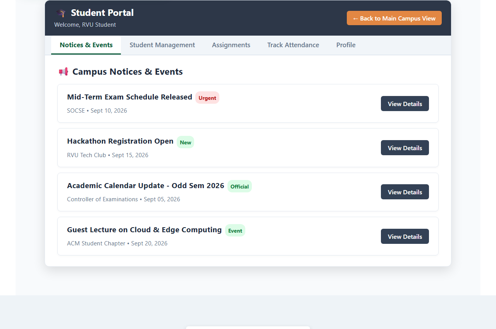<br/>
<b>2 · Student Portal Dashboard</b><br/>
<sub>Header badge, modular tabs, and campus circular notices.</sub>
</td>
</tr>
<tr>
<td width="50%" align="center" valign="top">
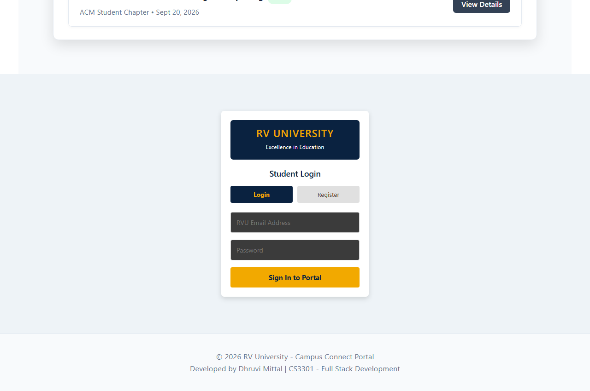<br/>
<b>3 · Authentication — Login</b><br/>
<sub>RV University login with email and password.</sub>
</td>
<td width="50%" align="center" valign="top">
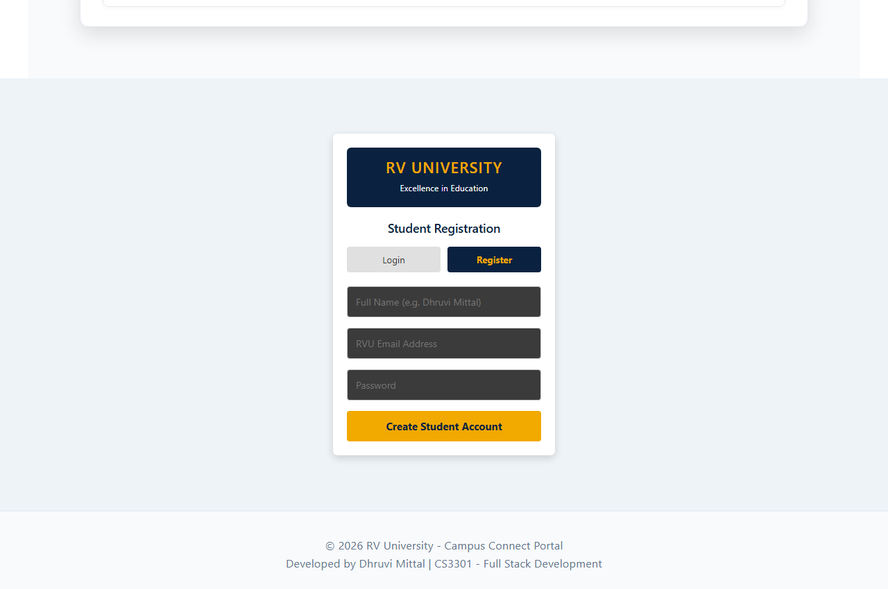<br/>
<b>4 · Authentication — Registration</b><br/>
<sub>New students create an account with name, email, and password.</sub>
</td>
</tr>
<tr>
<td width="50%" align="center" valign="top">
<br/>
<b>5 · Navigation & Modules</b><br/>
<sub>Notices & Events, Student Management (MongoDB), Assignments, Attendance, Profile.</sub>
</td>
<td width="50%" align="center" valign="top">
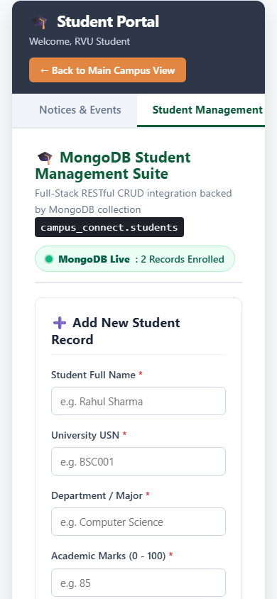<br/>
<b>6 · Responsive Mobile View</b><br/>
<sub>390px viewport: adaptive grids, wrapping cards, touch-friendly controls.</sub>
</td>
</tr>
</table>

### 🎓 B. Student Management & CRUD Suite

<table>
<tr>
<td width="50%" align="center" valign="top">
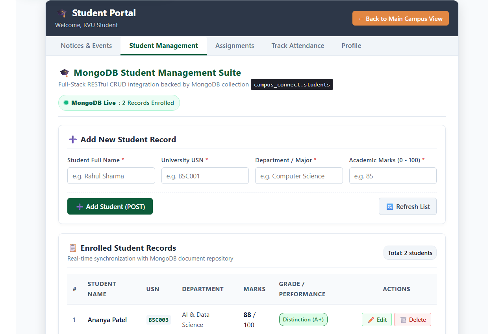<br/>
<b>7 · Suite Overview</b><br/>
<sub>Live DB connection telemetry, document counter, full layout.</sub>
</td>
<td width="50%" align="center" valign="top">
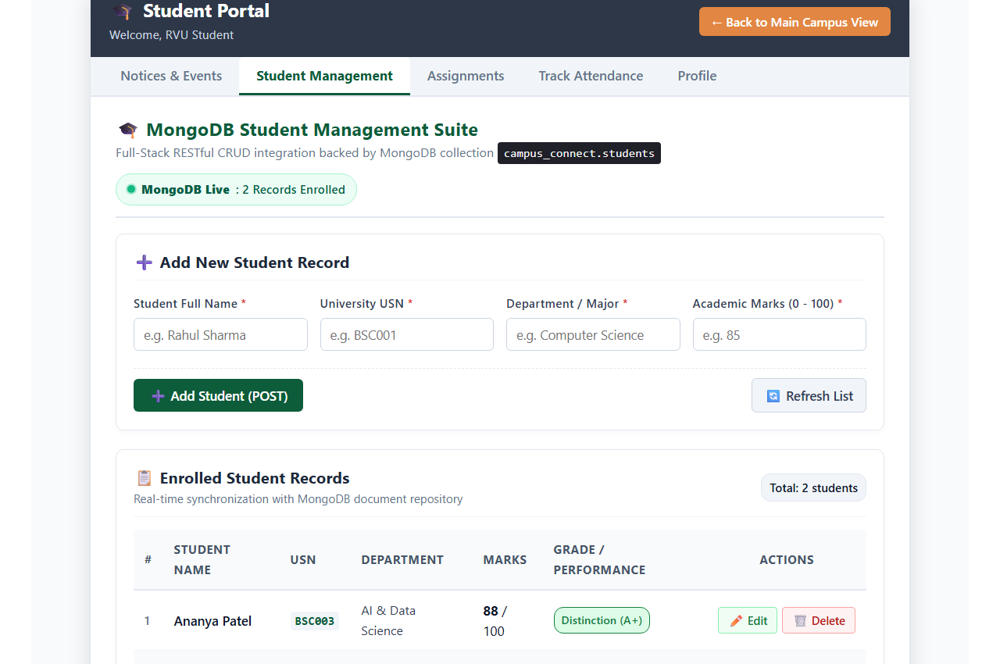<br/>
<b>8 · Add Student Form</b><br/>
<sub>Validated inputs for Name, USN, Department, Marks.</sub>
</td>
</tr>
<tr>
<td width="50%" align="center" valign="top">
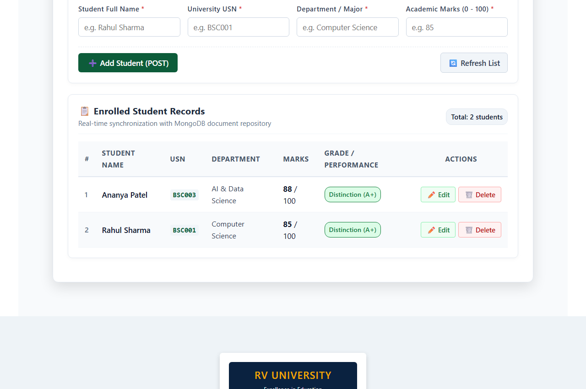<br/>
<b>9 · Records Table</b><br/>
<sub>BSON IDs, uppercase USNs, marks, grade badges, action buttons.</sub>
</td>
<td width="50%" align="center" valign="top">
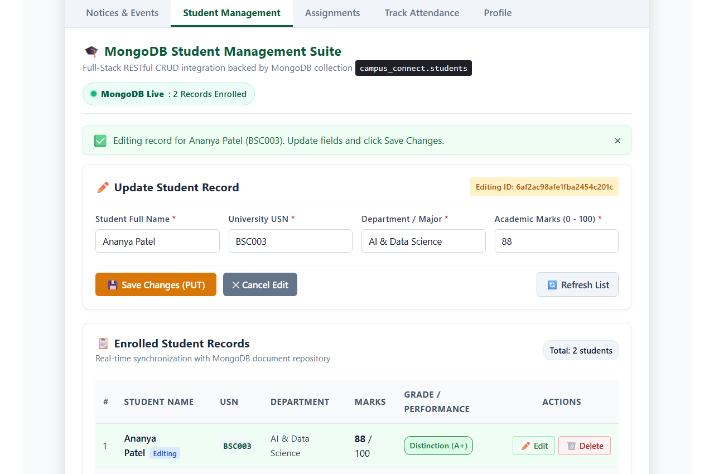<br/>
<b>10 · Inline Edit (PUT Mode)</b><br/>
<sub>Form auto-fills; switches to “Save Changes (PUT)” with cancel.</sub>
</td>
</tr>
<tr>
<td width="50%" align="center" valign="top">
<br/>
<b>11 · Update Confirmation</b><br/>
<sub>Success banner: marks updated to 85, reflected instantly.</sub>
</td>
<td width="50%" align="center" valign="top">
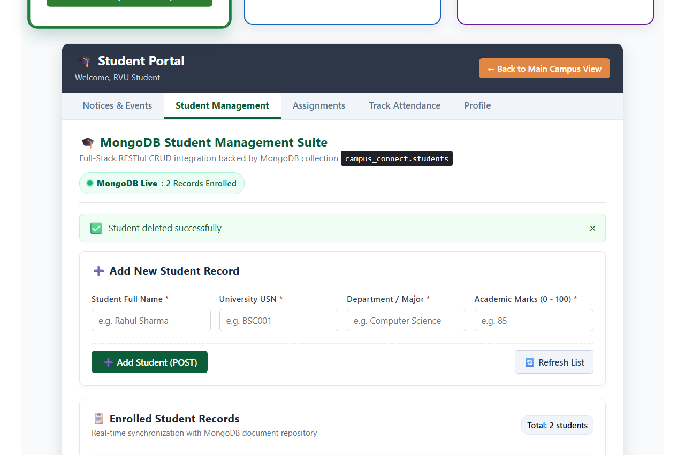<br/>
<b>12 · Delete & Reconciliation</b><br/>
<sub>Modal confirmation, permanent removal, table re-render.</sub>
</td>
</tr>
<tr>
<td colspan="2" align="center" valign="top">
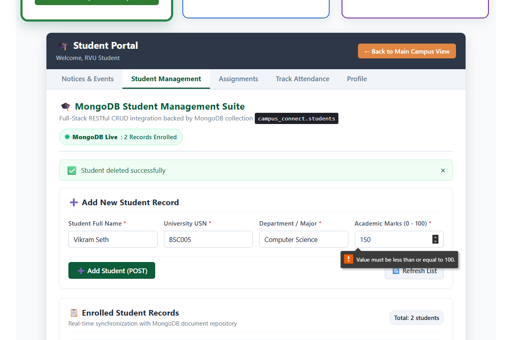<br/>
<b>13 · Frontend Validation</b><br/>
<sub>Real-time alert when marks exceed the allowed range (e.g. 150).</sub>
</td>
</tr>
</table>

### 🔌 C. Backend & REST API Verification

<table>
<tr>
<td width="50%" align="center" valign="top">
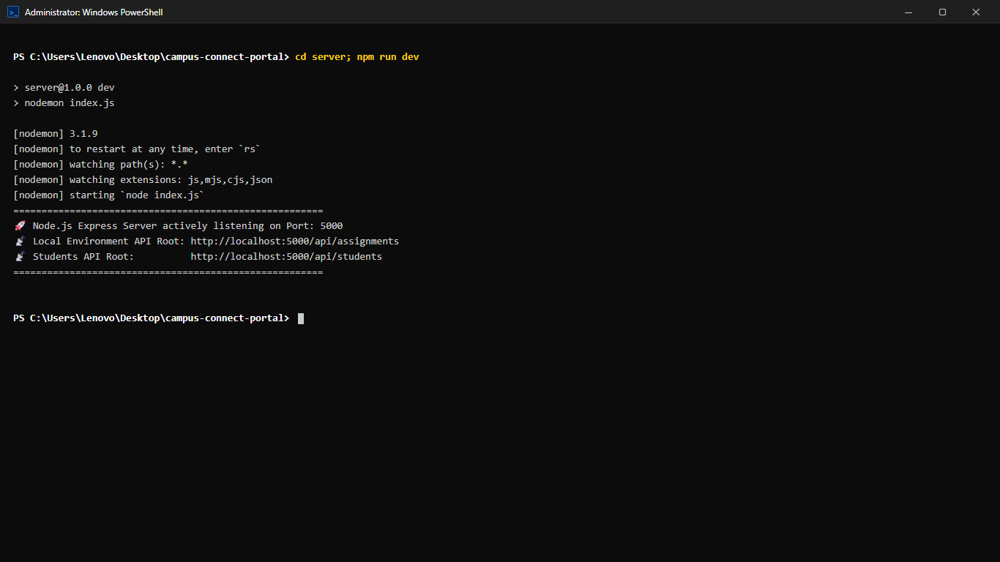<br/>
<b>14 · Express Server Running</b><br/>
<sub>PowerShell: <code>npm run dev</code> with nodemon 3.1.9 on port 5000.</sub>
</td>
<td width="50%" align="center" valign="top">
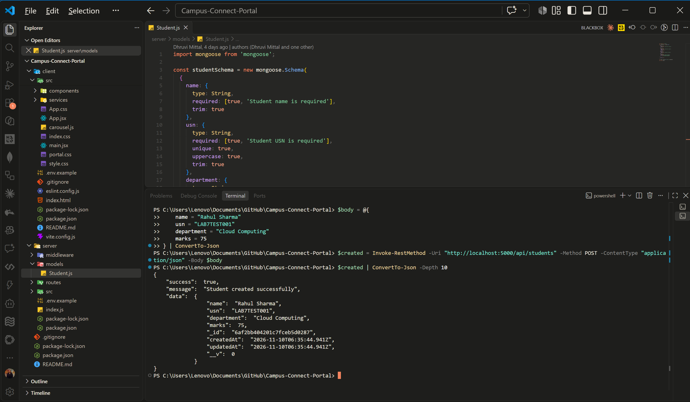<br/>
<b>15 · POST — Create (201)</b><br/>
<sub>Returns MongoDB <code>_id</code> and timestamps.</sub>
</td>
</tr>
<tr>
<td width="50%" align="center" valign="top">
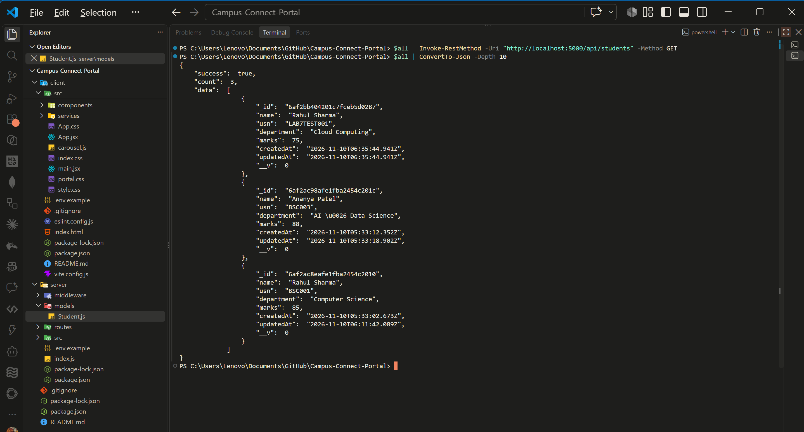<br/>
<b>16 · GET — All Students (200)</b><br/>
<sub>Structured array of every enrolled student.</sub>
</td>
<td width="50%" align="center" valign="top">
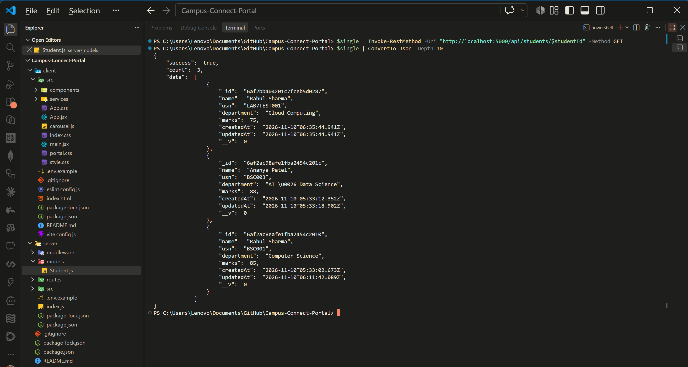<br/>
<b>17 · GET — Single by ID (200)</b><br/>
<sub>Single student document lookup.</sub>
</td>
</tr>
<tr>
<td width="50%" align="center" valign="top">
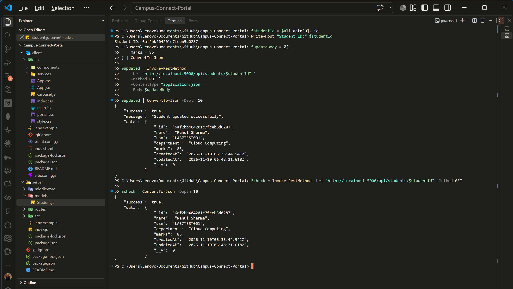<br/>
<b>18 · PUT — Update Marks (200)</b><br/>
<sub>Rahul Sharma's marks updated from 75 to 85.</sub>
</td>
<td width="50%" align="center" valign="top">
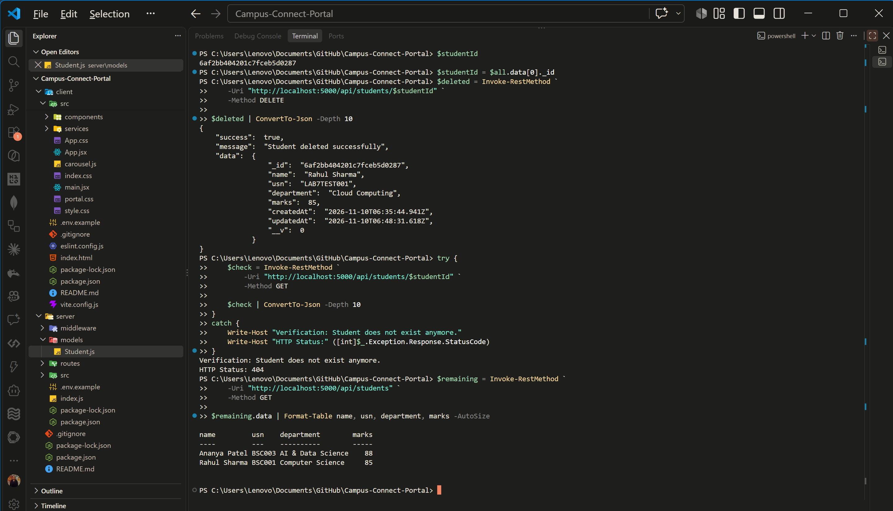<br/>
<b>19 · DELETE — Remove by ID (200)</b><br/>
<sub>Document deletion confirmed.</sub>
</td>
</tr>
<tr>
<td colspan="2" align="center" valign="top">
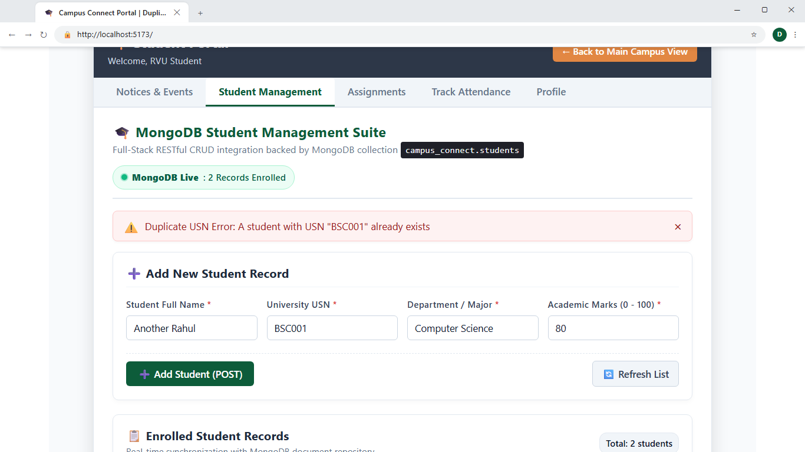<br/>
<b>20 · Duplicate USN Handling</b><br/>
<sub>Duplicate <code>BSC001</code> → <code>400 Bad Request</code>, shown as an alert in the React UI.</sub>
</td>
</tr>
</table>

### 🍃 D. MongoDB Database Evidence

<table>
<tr>
<td width="50%" align="center" valign="top">
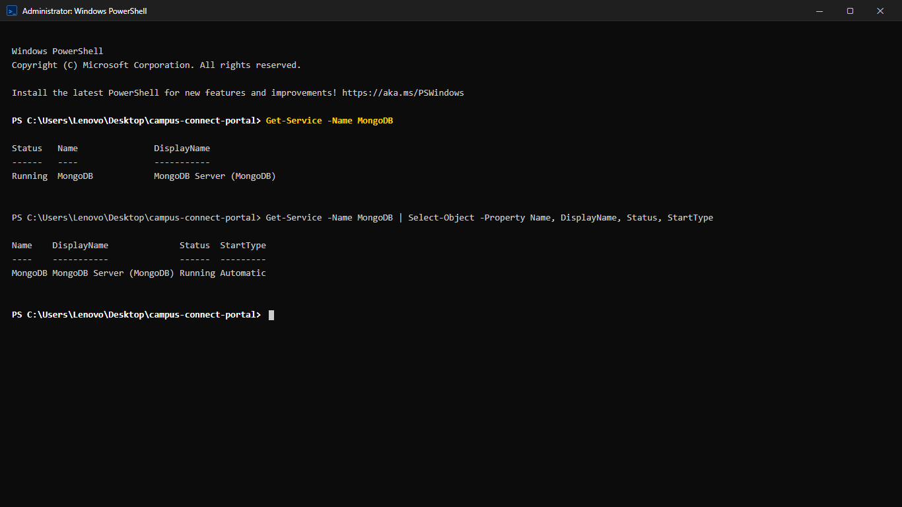<br/>
<b>21 · MongoDB Service Running</b><br/>
<sub><code>Get-Service -Name MongoDB</code> → Running on 27017.</sub>
</td>
<td width="50%" align="center" valign="top">
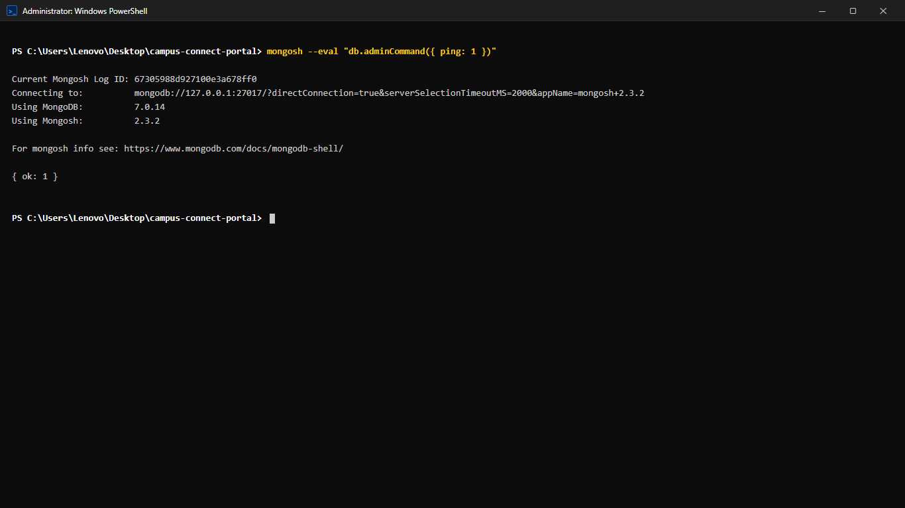<br/>
<b>22 · Loopback Ping</b><br/>
<sub><code>db.adminCommand({ ping: 1 })</code> → <code>{ ok: 1 }</code>.</sub>
</td>
</tr>
<tr>
<td width="50%" align="center" valign="top">
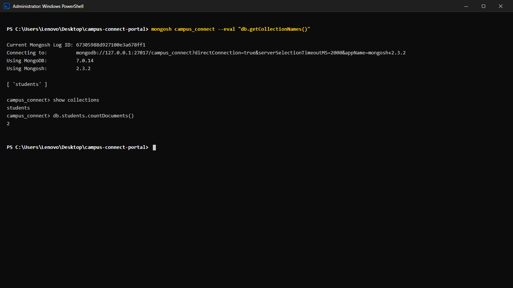<br/>
<b>23 · Database & Collection</b><br/>
<sub><code>campus_connect</code>, <code>students</code>, document counts.</sub>
</td>
<td width="50%" align="center" valign="top">
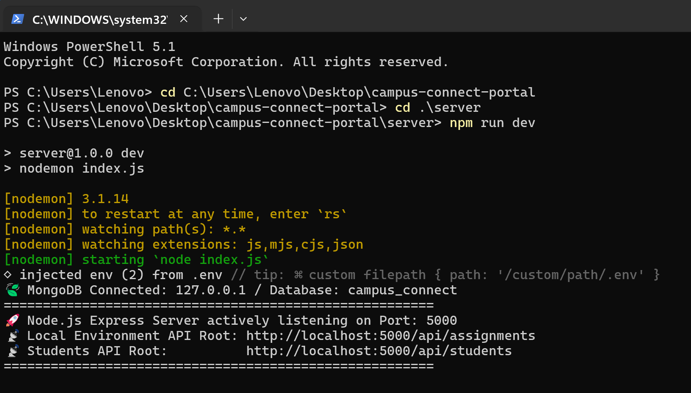<br/>
<b>24 · Express ↔ MongoDB Handshake</b><br/>
<sub>Mongoose logs <code>MongoDB Connected: 127.0.0.1 / campus_connect</code>.</sub>
</td>
</tr>
<tr>
<td width="50%" align="center" valign="top">
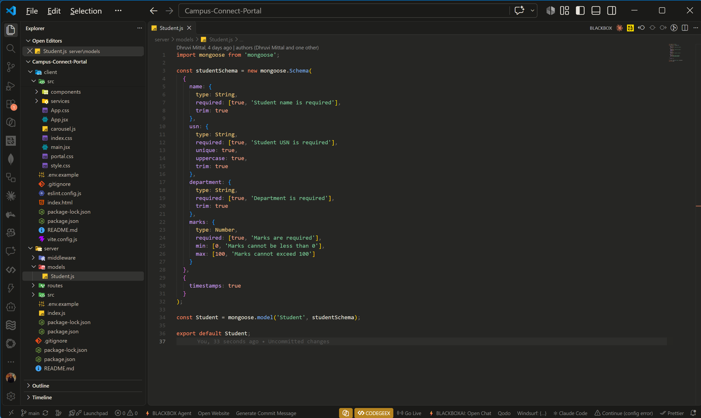<br/>
<b>25 · Mongoose Schema Code</b><br/>
<sub>Validation rules, unique uppercase USN index, timestamps.</sub>
</td>
<td width="50%" align="center" valign="top">
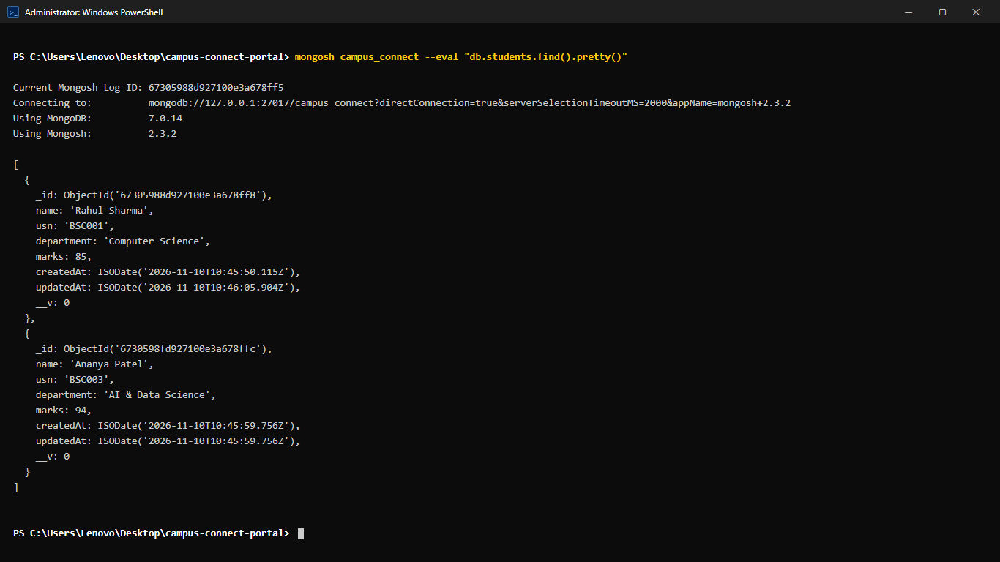<br/>
<b>26 · <code>mongosh</code> Verification</b><br/>
<sub><code>db.students.find().pretty()</code> shows persistent BSON with ISO timestamps.</sub>
</td>
</tr>
</table>


---

## 🧪 Testing & Verification

| Area | What was tested |
|:--|:--|
| 🖥️ **Frontend Integration** | Add / edit / delete via real DOM events in Edge and Chrome using Puppeteer; page-refresh persistence confirmed with zero state loss |
| 🔌 **REST API** | All CRUD endpoints via Postman and Axios; edge cases: duplicate USNs, non-existent ObjectIds (`404`), marks `> 100`, empty required fields |
| 🍃 **Database Integrity** | Direct BSON document creation and index adherence checked in `mongosh` |


---

## 🔮 Future Enhancements

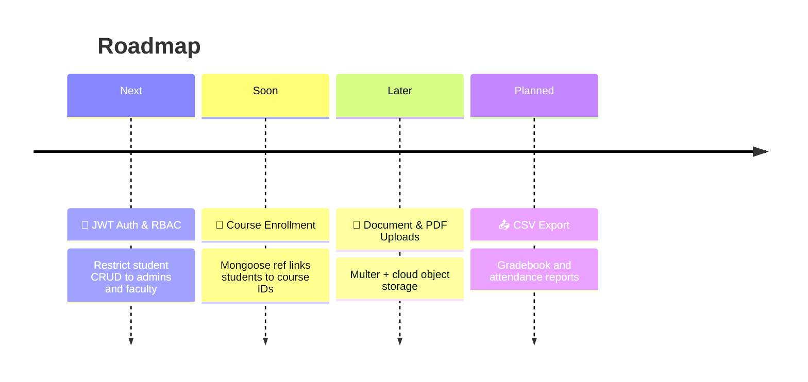

- [ ] **JWT Authentication & RBAC**
- [ ] **Course Enrollment Relationships** via Mongoose `ref`
- [ ] **Document & PDF Uploads** with Multer and cloud storage
- [ ] **CSV Data Export** for gradebooks and attendance


---

## 👤 Author

<div align="center">


### **Dhruvi Mittal**

**RV University** — School of Computer Science & Engineering
*B.Sc. (Hons) Computer Science • Specialization in Cloud Computing*
*CS3301 — Full Stack Development*

<a href="https://github.com/Dhruvi-tech"></a>
<a href="mailto:dhruvimittalbsc24@rvu.edu.in"></a>

<br/><br/>


<br/>

<sub>&copy; 2026 RV University • Campus Connect Portal • Engineered by Dhruvi Mittal</sub>

<br/><br/>


</div>
