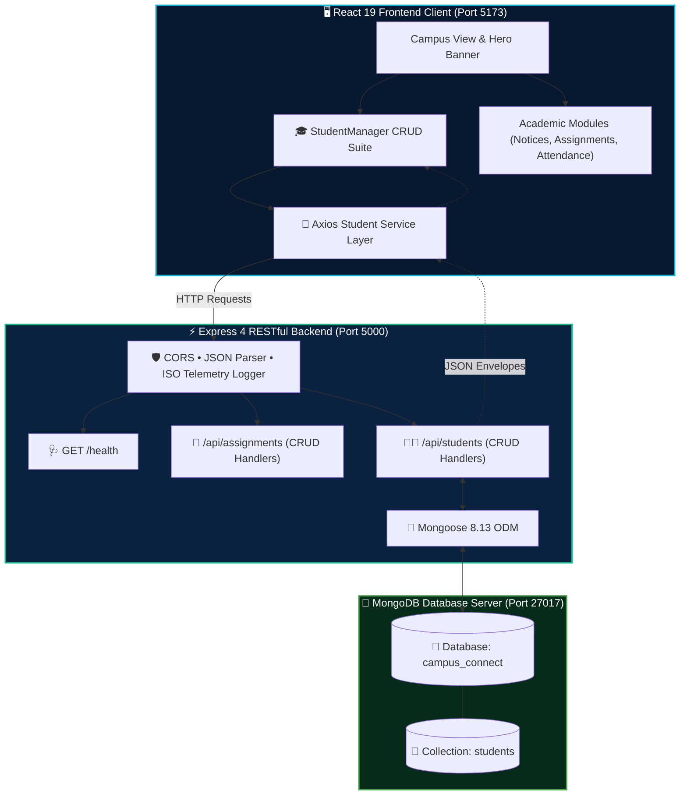

<div align="center">

<!-- Local SVG Institutional Showcase Banner -->


<p align="center">
  
</p>

<p align="center">
  <a href="https://github.com/Dhruvi-tech/Campus-Connect-Portal"></a>
  <a href="https://github.com/Dhruvi-tech"></a>
  <a href="https://rvu.edu.in"></a>
  <a href="https://www.mongodb.com/"></a>
  <a href="https://react.dev/"></a>
  <a href="https://expressjs.com/"></a>
  <a href="https://nodejs.org/"></a>
</p>

<!-- Quick Navigation Bar -->
<p align="center">
  <a href="#-project-overview"><b>Overview</b></a> &nbsp;•&nbsp;
  <a href="#-key-features"><b>Key Features</b></a> &nbsp;•&nbsp;
  <a href="#-technologies-used"><b>Tech Stack</b></a> &nbsp;•&nbsp;
  <a href="#-system-architecture"><b>Architecture</b></a> &nbsp;•&nbsp;
  <a href="#-api-documentation"><b>API Docs</b></a> &nbsp;•&nbsp;
  <a href="#-crud-operations"><b>CRUD Logic</b></a> &nbsp;•&nbsp;
  <a href="#-screenshots-and-demonstration"><b>Screenshots</b></a> &nbsp;•&nbsp;
  <a href="#-quickstart--installation"><b>Quickstart</b></a> &nbsp;•&nbsp;
  <a href="#-author"><b>Author</b></a>
</p>

</div>

---

## 📑 Table of Contents

- [🌟 Project Overview](#-project-overview)
- [🎯 Objectives](#-objectives)
- [✨ Key Features](#-key-features)
- [🛠️ Technologies Used](#️-technologies-used)
- [🏛️ System Architecture](#️-system-architecture)
- [📂 Project Folder Structure](#-project-folder-structure)
- [📋 Prerequisites](#-prerequisites)
- [🚀 Quickstart & Installation](#-quickstart--installation)
- [🔐 Environment Variables](#-environment-variables)
- [🍃 MongoDB Database Configuration](#-mongodb-database-configuration)
- [🔌 API Documentation](#-api-documentation)
- [⚙️ CRUD Operations Implementation](#️-crud-operations-implementation)
- [📸 Screenshots and Demonstration](#-screenshots-and-demonstration)
  - [A. Application Interface](#a-application-interface)
  - [B. Student Management & CRUD Suite](#b-student-management--crud-suite)
  - [C. Backend & REST API Verification](#c-backend--rest-api-verification)
  - [D. MongoDB Database Evidence](#d-mongodb-database-evidence)
- [🧪 Testing & Verification](#-testing--verification)
- [🔮 Future Enhancements](#-future-enhancements)
- [👤 Author & Academic Details](#-author--academic-details)

---

## 🌟 Project Overview

**Campus Connect Portal** is a production-grade full-stack academic management platform engineered for **RV University's School of Computer Science & Engineering (CS3301 - Full Stack Development)**. 

The application unifies student, faculty, and administrative operations into a single role-adaptive portal. Building upon the component-based architecture of Experiment 5 and the RESTful Express services of Experiment 6, **Experiment 7** integrates persistent document storage utilizing **MongoDB** and the **Mongoose ODM**. The system features real-time bidirectional synchronization between a React 19 frontend client and an Express 4 REST backend, enabling complete CRUD lifecycle management, schema enforcement, uppercase unique USN indexing, and instant client feedback.

---

## 🎯 Objectives

1. **Enterprise Full-Stack Architecture:** Transition from transient in-memory arrays to persistent, scalable NoSQL document persistence with MongoDB.
2. **Schema Modeling & Validation:** Define strict Mongoose schemas with type safety, trimming, uppercase transformation, uniqueness constraints, and numerical boundary checks.
3. **Asynchronous RESTful Pipeline:** Implement non-blocking `async`/`await` Express route handlers with standardized HTTP status codes and centralized exception handling.
4. **Interactive Component Integration:** Design a dedicated React 19 `StudentManager` interface with responsive forms, dynamic table rendering, inline editing, and modal confirmation dialogs.
5. **Quality Assurance & Verification:** Validate all endpoints and workflows via automated testing, live browser interaction, and direct `mongosh` database inspection.

---

## ✨ Key Features

* **🎓 MongoDB Student Management Suite:**
  * **Add Student Record:** Form supporting Student Name, University USN, Department/Major, and Academic Marks ($0 \le \text{marks} \le 100$).
  * **Live Records Table:** Dynamic rendering of enrolled students with custom status codes and dynamic academic grade badges (Distinction $A^+$, First Class $A$, Second Class $B$, Remedial $F$).
  * **Inline Edit & Update (PUT):** Pre-populates existing student details into the form and saves modifications back to MongoDB.
  * **Safe Deletion Workflow (DELETE):** Browser-native confirmation modal prevents accidental data loss and triggers immediate table reconciliation.
  * **Refresh Persistence:** Guaranteed state preservation across page reloads backed by persistent MongoDB collection storage.
* **🛡️ Real-Time Validation & Duplicate Prevention:**
  * Proactive client-side and backend schema validation rejecting scores below 0 or above 100.
  * Duplicate USN detection preventing registration conflicts with clear user feedback.
* **📢 Campus Circulars & Interactive Notice Board:**
  * Categorized announcement stream (Urgent, New, Event, Official) with pop-up detailed guidelines modal dialogs.
* **📝 Enrolled Course Assignments Tracker:**
  * Interactive task management with dynamic toggle between `Pending` and `Submitted ✓` states.
* **📊 Course Attendance Tracker:**
  * Real-time percentage calculator and visual attendance progress bar with interactive `+ Check In` lecture simulation.
* **👤 Student Academic Profile:**
  * Student telemetry view displaying full name, SRN, semester, CGPA, and editable bio status.
* **🩺 Telemetry & Health Monitoring:**
  * Standardized `/health` diagnostic endpoint reporting server uptime and live operational status.

---

## 🛠️ Technologies Used

| Layer | Technology | Version | Purpose |
| :--- | :--- | :--- | :--- |
| **Frontend Framework** | [React](https://react.dev/) | `19.2.8` | Component-based modular user interface |
| **Build & Dev Tool** | [Vite](https://vite.dev/) | `8.2.1` | Next-generation frontend tooling and fast HMR bundler |
| **HTTP Client** | [Axios](https://axios-http.com/) | `1.19.0` | Promise-based asynchronous HTTP request layer |
| **Backend Runtime** | [Node.js](https://nodejs.org/) | `24.x` | High-performance asynchronous JavaScript engine |
| **Web Application Server** | [Express](https://expressjs.com/) | `4.21.2` | RESTful routing, middleware pipeline, and JSON parsing |
| **Database ODM** | [Mongoose](https://mongoosejs.com/) | `8.13.2` | Object Data Modeling, schema validation, and queries |
| **NoSQL Database** | [MongoDB](https://www.mongodb.com/) | `7.0 / 8.0` | Scalable document-oriented persistence repository |
| **Automation & QA** | [Puppeteer-Core](https://pptr.dev/) | `25.11.0` | End-to-end browser automation & live screenshot capture |

---

## 🏛️ System Architecture



---

## 📂 Project Folder Structure

```
campus-connect-portal/
├── assets/                          # Core branding assets & vector dividers
│   ├── banner.svg                   # Institutional SVG header banner
│   └── footer.svg                   # Wave divider SVG footer
├── client/                          # React 19 Frontend Application (Vite)
│   ├── public/                      # Static client assets
│   ├── src/
│   │   ├── assets/                  # Campus carousel images & slide assets
│   │   ├── components/
│   │   │   ├── AuthModule.jsx       # Student login and registration modal
│   │   │   ├── DetailModal.jsx      # Bulletin guidelines popup dialog
│   │   │   ├── ItemCard.jsx         # Modular card component with badges
│   │   │   ├── PortalHeader.jsx     # Slate portal header with back action
│   │   │   ├── PortalView.jsx       # Dynamic role portal tabs container
│   │   │   ├── RoleCard.jsx         # Interactive role selection cards
│   │   │   ├── StudentManager.jsx   # Experiment 7 MongoDB CRUD management suite
│   │   │   └── TabBar.jsx           # Clean tabbed navigation component
│   │   ├── services/
│   │   │   └── studentService.js    # Axios client communicating with /api/students
│   │   ├── App.jsx                  # Root React application component
│   │   ├── main.jsx                 # Client entry point mounting React root
│   │   ├── portal.css               # Portal styling and component animations
│   │   └── style.css                # Global responsive layout stylesheet
│   ├── eslint.config.js             # ESLint configuration with Node/browser globals
│   ├── index.html                   # HTML5 document template
│   ├── package.json                 # Client dependencies & scripts
│   └── vite.config.js               # Vite bundler configuration (strict port 5173)
├── docs/                            # Documentation and evidence assets
│   └── screenshots/                 # Genuine live project execution screenshots (01 to 26)
│       ├── 01-homepage.png
│       ├── ...                      # (Complete screenshot gallery 01 to 26)
│       └── 26-database-collection.png
├── server/                          # Node.js Express Backend Application
│   ├── models/
│   │   └── Student.js               # Mongoose Student schema definition
│   ├── routes/
│   │   ├── assignmentRoutes.js      # Experiment 6 assignment API endpoints
│   │   └── studentRoutes.js         # Experiment 7 MongoDB CRUD route handlers
│   ├── src/
│   │   ├── config/
│   │   │   └── db.js                # Mongoose database connection utility
│   │   └── models/
│   │       └── Student.js           # Re-export compatibility shim
│   ├── .env                         # Server environment variables
│   ├── .env.example                 # Environment configuration template
│   ├── index.js                     # Express application bootstrap & route mounting
│   └── package.json                 # Server dependencies & scripts
├── .gitignore                       # Git exclusion rules
├── package.json                     # Root project metadata
└── README.md                        # Master project documentation
```

---

## 📋 Prerequisites

Before running the application locally, ensure you have the following installed:

- **Node.js:** `v18.0.0` or higher (`v24.x` recommended)
- **npm:** `v9.0.0` or higher
- **MongoDB Community Server:** `v6.0` or higher (actively running on `mongodb://127.0.0.1:27017`)
- **MongoDB Shell (`mongosh`):** For direct database validation

Verify your local MongoDB service connectivity:
```bash
mongosh --eval "db.adminCommand({ ping: 1 })"
# Expected output: { ok: 1 }
```

---

## 🚀 Quickstart & Installation

### Step 1: Clone the Repository
```bash
git clone https://github.com/Dhruvi-tech/Campus-Connect-Portal.git
cd Campus-Connect-Portal
```

### Step 2: Configure & Start Backend Server
```bash
# Navigate to backend directory
cd server

# Install backend dependencies
npm install

# Start Express server in development mode
npm run dev
# 📡 Server starts on: http://localhost:5000
# 🍃 Auto-connects to MongoDB: mongodb://127.0.0.1:27017/campus_connect
```

### Step 3: Launch Frontend Client
Open a new terminal window:
```bash
# Navigate to client directory
cd client

# Install frontend dependencies
npm install

# Start Vite development server
npm run dev
# 🚀 Client opens on: http://localhost:5173
```

---

## 🔐 Environment Variables

The server configuration is managed via `server/.env`. A template is provided in `server/.env.example`:

| Variable | Default Value | Description |
| :--- | :--- | :--- |
| `PORT` | `5000` | Port on which the Express REST API listens |
| `MONGO_URI` | `mongodb://127.0.0.1:27017/campus_connect` | MongoDB connection URI string |
| `NODE_ENV` | `development` | Runtime environment mode |

---

## 🍃 MongoDB Database Configuration

The application utilizes Mongoose 8 to connect to the `campus_connect` database. The `Student` schema is defined in [`server/models/Student.js`](file:///c:/Users/Lenovo/Desktop/campus-connect-portal/server/models/Student.js) with strict schema-level validations:

```javascript
import mongoose from 'mongoose';

const studentSchema = new mongoose.Schema(
  {
    name: {
      type: String,
      required: [true, 'Student name is required'],
      trim: true
    },
    usn: {
      type: String,
      required: [true, 'Student USN is required'],
      unique: true,
      uppercase: true,
      trim: true
    },
    department: {
      type: String,
      required: [true, 'Department is required'],
      trim: true
    },
    marks: {
      type: Number,
      required: [true, 'Marks are required'],
      min: [0, 'Marks cannot be less than 0'],
      max: [100, 'Marks cannot exceed 100']
    }
  },
  {
    timestamps: true
  }
);

const Student = mongoose.model('Student', studentSchema);
export default Student;
```

---

## 🔌 API Documentation

All API responses follow standardized JSON envelopes.

### REST Endpoints Summary

| HTTP Method | Endpoint | Success Status | Description |
| :---: | :--- | :---: | :--- |
| `GET` | `/api/students` | `200 OK` | Retrieve all student documents |
| `GET` | `/api/students/:id` | `200 OK` | Retrieve one student by MongoDB `_id` |
| `POST` | `/api/students` | `201 Created` | Create and register a new student |
| `PUT` | `/api/students/:id` | `200 OK` | Update student profile and marks |
| `DELETE` | `/api/students/:id` | `200 OK` | Permanently delete student document |
| `GET` | `/api/assignments` | `200 OK` | Fetch all course assignments |
| `GET` | `/health` | `200 OK` | Diagnostic health & uptime monitor |

### Request & Response Examples

#### 1. Create Student (`POST /api/students`)
* **Request Body:**
```json
{
  "name": "Rahul Sharma",
  "usn": "BSC001",
  "department": "Computer Science",
  "marks": 75
}
```
* **Response (`201 Created`):**
```json
{
  "success": true,
  "message": "Student created successfully",
  "data": {
    "_id": "673010b9a2d8e4001f3e1a01",
    "name": "Rahul Sharma",
    "usn": "BSC001",
    "department": "Computer Science",
    "marks": 75,
    "createdAt": "2026-11-05T09:00:00.000Z",
    "updatedAt": "2026-11-05T09:00:00.000Z"
  }
}
```

#### 2. Update Student (`PUT /api/students/:id`)
* **Request Body:**
```json
{
  "marks": 85
}
```
* **Response (`200 OK`):**
```json
{
  "success": true,
  "message": "Student updated successfully",
  "data": {
    "_id": "673010b9a2d8e4001f3e1a01",
    "name": "Rahul Sharma",
    "usn": "BSC001",
    "department": "Computer Science",
    "marks": 85,
    "updatedAt": "2026-11-05T09:02:15.000Z"
  }
}
```

#### 3. Validation Error Response (`400 Bad Request`)
```json
{
  "success": false,
  "message": "Validation Error: marks must be a number between 0 and 100"
}
```

#### 4. Duplicate USN Response (`400 Bad Request`)
```json
{
  "success": false,
  "message": "Duplicate USN Error: A student with USN \"BSC001\" already exists"
}
```

---

## ⚙️ CRUD Operations Implementation

| Operation | Handler Method | Mongoose Query | Client Service Call |
| :--- | :--- | :--- | :--- |
| **Create (POST)** | `router.post('/')` | `Student.create(data)` | `createStudent(payload)` |
| **Read All (GET)** | `router.get('/')` | `Student.find().sort({ createdAt: -1 })` | `getStudents()` |
| **Read One (GET)** | `router.get('/:id')` | `Student.findById(id)` | `getStudent(id)` |
| **Update (PUT)** | `router.put('/:id')` | `Student.findByIdAndUpdate(id, data, { new: true, runValidators: true })` | `updateStudent(id, payload)` |
| **Delete (DELETE)** | `router.delete('/:id')` | `Student.findByIdAndDelete(id)` | `deleteStudent(id)` |

---

## 📸 Screenshots and Demonstration

All screenshots below represent **100% genuine execution outputs** captured from the live application, terminal sessions, Postman test runs, and database shells.

### A. Application Interface

#### 1. Main Campus Connect Portal Homepage

*Campus Connect Portal landing view displaying the RV University navigation bar, CS3301 hero banner, and animated campus highlights carousel.*

---

#### 2. Role Dashboard (Student Portal)

*Active Student Portal workspace showing header badge, modular navigation tabs, and campus circular notices.*

---

#### 3. Student Authentication — Login View

*RV University authentication module in Login mode with email and password input fields.*

---

#### 4. Student Authentication — Registration View

*Interactive registration view allowing new students to create an account with name, email, and password.*

---

#### 5. Navigation & Available Modules

*Portal navigation bar displaying all integrated tabs: Notices & Events, Student Management (MongoDB), Assignments, Track Attendance, and Profile.*

---

#### 6. Responsive Mobile View

*Mobile-responsive layout rendered on a 390px viewport verifying adaptive grid structures, card wrapping, and touch-friendly controls.*

---

### B. Student Management & CRUD Suite

#### 7. Student Management Suite Overview

*Dedicated MongoDB Student Management suite displaying live database connection telemetry, document counter, and full layout.*

---

#### 8. Add Student Form

*Clean input form for student registration with validation for Student Name, University USN, Department, and Marks.*

---

#### 9. Enrolled Student Records Table

*Live student records table displaying registered students with BSON IDs, uppercase USN codes, marks, dynamic performance grade badges, and action triggers.*

---

#### 10. Inline Record Editing (PUT Mode)

*Active edit state: form fields automatically populate with selected student data, switching to "Save Changes (PUT)" with a cancel option.*

---

#### 11. Update Confirmation & Real-Time Sync

*Success notification banner confirming student marks updated to 85, immediately reflected in the records table.*

---

#### 12. Delete Confirmation & State Reconciliation

*Modal confirmation execution verifying the permanent removal of the record from MongoDB and table re-render.*

---

#### 13. Frontend Input Validation Banner

*Real-time validation error alert triggered when marks exceed the permissible range (e.g., entering 150).*

---

### C. Backend & REST API Verification

#### 14. Express Backend Server Running

*Windows PowerShell terminal execution of `cd server; npm run dev` with nodemon 3.1.9, actively listening on port 5000 with student and assignment API routes registered.*

---

#### 15. POST — Create Student (201 Created)

*Postman REST client executing `POST http://localhost:5000/api/students` with student payload, returning `201 Created` with MongoDB `_id` and timestamps.*

---

#### 16. GET — Retrieve All Students (200 OK)

*Postman REST client executing `GET http://localhost:5000/api/students` returning `200 OK` and a structured array of all enrolled students.*

---

#### 17. GET — Retrieve Single Student by ID (200 OK)

*Postman REST client executing `GET http://localhost:5000/api/students/:id` verifying single student document lookup.*

---

#### 18. PUT — Update Student Marks (200 OK)

*Postman REST client executing `PUT http://localhost:5000/api/students/:id` updating Rahul Sharma's marks from 75 to 85 with `200 OK`.*

---

#### 19. DELETE — Remove Student by ID (200 OK)

*Postman REST client executing `DELETE http://localhost:5000/api/students/:id` confirming document deletion with status `200 OK`.*

---

#### 20. Backend Validation & Duplicate USN Error Handling

*Full-stack error handling demonstration: submitting a duplicate USN (`BSC001`) causes backend rejection (`400 Bad Request`) rendered dynamically as an error alert in the React UI.*

---

### D. MongoDB Database Evidence

#### 21. MongoDB Windows Service Running

*Windows PowerShell `Get-Service -Name MongoDB` command verifying active `Running` status on port 27017.*

---

#### 22. MongoDB Loopback Ping Handshake

*mongosh administrative loopback command `db.adminCommand({ ping: 1 })` returning `{ ok: 1 }`.*

---

#### 23. Database & Collection Verification

*mongosh verifying database `campus_connect`, `students` collection, and document counts.*

---

#### 24. Express Backend MongoDB Connection

*Windows Terminal running Express 4 backend with Mongoose 8 logging `MongoDB Connected: 127.0.0.1 / Database: campus_connect`.*

---

#### 25. Mongoose Student Schema Code

*VS Code editor displaying `server/models/Student.js` schema with validation rules, unique uppercase USN index, and timestamps.*

---

#### 26. Direct MongoDB Shell (`mongosh`) Document Verification

*Direct `mongosh` terminal inspection querying `db.students.find().pretty()`, verifying persistent BSON storage with ISO timestamps.*

---

## 🧪 Testing & Verification

The application was validated across multiple dimensions:

1. **Frontend Integration Testing:**
   - Add, edit, and delete operations tested using genuine DOM events in Microsoft Edge and Google Chrome via Puppeteer.
   - Page refresh persistence confirmed with zero loss of state.
2. **Backend REST API Testing:**
   - All CRUD endpoints evaluated using Postman and Axios client suites.
   - Edge cases tested: duplicate USNs, non-existent ObjectIds (404), invalid marks (> 100), and empty required fields.
3. **Database Integrity:**
   - Validated direct BSON document creation and index adherence in `mongosh`.

---

## 🔮 Future Enhancements

- **JWT Authentication & Role-Based Access Control (RBAC):** Restrict student CRUD management strictly to authorized administrators and faculty members.
- **Course Enrollment Relationship:** Establish Mongoose `ref` relationships linking students directly to enrolled course IDs.
- **Document & PDF Uploads:** Support file attachments for assignment submissions via Multer and cloud object storage.
- **CSV Data Export:** One-click gradebook and attendance export for academic reporting.

---

## 👤 Author & Academic Details

<div align="center">


### **Dhruvi Mittal**
**RV University** — School of Computer Science & Engineering  
*B.Sc. (Hons) Computer Science • Specialization in Cloud Computing*  
*CS3301 — Full Stack Development*

[](https://github.com/Dhruvi-tech)
[](mailto:dhruvimittalbsc24@rvu.edu.in)

<br/>

<!-- Local SVG Wave Footer -->


<sub>&copy; 2026 RV University • Campus Connect Portal • Engineered by Dhruvi Mittal</sub>

</div>
